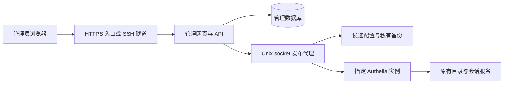

# Authelia Client Manager 实施方案

版本：0.1　状态：第一版已实现，实施记录见下文　编写日期：2026-10-27

本项目提供一个自托管的 Authelia OIDC 客户端管理网页。管理员通过表单登记应用、生成凭据、检查变更并发布，完成日常接入工作。项目按开源标准开发，代码、示例、测试和截图只使用虚构数据。实际部署地址、现有客户端、人员信息、密钥、备份及操作记录均保留在部署方私有环境。

## 1 项目范围与交付目标

第一版支持单个 Authelia 实例，先适配已验证的 4.39.1 版本。新增版本需经过相同集成测试后列入兼容表，不将当前在线文档中的新字段直接套用到旧版实例。

第一版交付：

- 应用列表与详情，区分生产配置、待发布修改和外部变更。
- 表单新增、修改、停用、恢复客户端，开发、测试、生产分别登记。
- 凭据生成、限时领取、轮换；现有凭据仅显示是否已配置。
- 配置校验、脱敏变更预览、显式发布、历史记录及安全回滚。
- 一键复制不含密钥的接入参数，导出通用接入规范和申请模板。
- 本地管理员登录、TOTP 双因素认证、管理员与只读审计员角色。
- Docker Compose 应用部署、宿主机发布代理、演示环境和开源文档。

后续版本再考虑开发人员自助申请、审批流、外部 OIDC 登录、更多实例和其他身份提供方。第一版不管理员工、LDAP、HR 同步或全局认证策略，不实现新的身份提供方。

## 2 已确认的技术前提

Authelia 官方支持表将动态客户端注册列为不支持。4.39.1 的客户端存储由配置初始化为内存映射，因此本项目不直接修改 Authelia 数据库、不假设存在客户端增删 API。发布按“写入配置并受控重启目标实例”设计，零中断热更新不作为承诺。上线前在隔离实例中实测发布时延和会话表现。

4.39.1 已提供 `authelia validate-config` 以及 PBKDF2-SHA512 密钥摘要生成工具。候选配置必须通过与目标实例一致的版本和配置加载环境校验。

第一版支持明确指定的单个 YAML 配置文件。遇到未支持的多文件覆盖、模板过滤、环境变量覆盖客户端列表或复杂 YAML 别名时，进入只读模式并给出原因，禁止猜测有效配置后写入。

## 3 技术选型

| 层次 | 方案 | 说明 |
| --- | --- | --- |
| 页面 | React、TypeScript、Vite | 中文优先，预留英文语言包；静态资源随后端打包 |
| API | Python 3.12、FastAPI、Pydantic | 结构化校验、同源接口、生成 OpenAPI |
| 数据 | SQLite WAL、SQLAlchemy、Alembic | 单实例、低并发管理场景；保留后续数据库迁移空间 |
| 配置处理 | ruamel.yaml | 保留注释和未知字段；拒绝重复键及危险标签 |
| 管理员认证 | Argon2id、TOTP、服务端会话 | 独立于被管理的 Authelia，避免故障时无法进入管理页 |
| 发布代理 | Python 宿主机服务、systemd | Unix socket 通信，固定操作集合 |
| 测试 | pytest、Playwright、隔离 Authelia 实例 | 覆盖发布失败、并发、恢复和实际 OIDC 流程 |
| 交付 | 多阶段 Docker 构建、Compose、GitHub Actions | 运行非 root；固定依赖锁文件和发布镜像 digest |

具体依赖小版本在实施时选择受维护版本并锁定，不使用浮动 latest 作为可复现部署依据。服务器只运行构建产物，默认不在服务器执行前端构建。

## 4 架构与权限边界



网页容器不挂载 Docker socket、不读取原始 Authelia 配置，也不持有宿主机 SSH 私钥。仅发布代理可读取配置、写入受限位置并管理预先指定的 Authelia 容器。

发布代理的目标路径、实例标识、允许操作及健康检查地址由宿主机私有配置固定，网页请求不能传入任意命令、容器名、路径或探测 URL。代理接收的是结构化的客户端修改，不接收可直接执行的脚本或整份任意配置。

Unix socket 仅授予管理服务访问权限，并校验本地调用者。代理目录和程序不可由网页进程改写；网页只拥有独立数据卷及 socket 连接权限。代理若具备 Docker daemon 权限，本质上属于高权限组件，不能以“有限 API”声称其本身已无宿主机风险；通过小代码面、固定操作、systemd 限制及审计降低风险。

默认只监听回环地址。对局域网开放前配置可验证的 HTTPS 和明确的访问来源限制。登录授权在应用内执行，代理传来的用户身份头不作为默认信任依据。

## 5 页面与使用流程

### 5.1 应用列表

展示名称、环境、Client ID、负责人、状态、最近发布时间及是否存在配置漂移。列表不展示密钥、原始 YAML 或其他基础服务信息。

### 5.2 新增与修改

基础表单包含名称、负责人、环境、客户端类型、回调 URI、资料范围及认证强度。默认生成授权码模式、S256 PKCE、`openid profile email`；申请部门信息时添加 `groups`。

高级选项仅开放经过适配测试的白名单字段。导入客户端未支持的高级字段保留原值；如果无法安全编辑，该客户端只读。修改时不会给存量客户端自动补默认值，更不会批量重置其 ID、密钥、回调、subject 相关参数或授权策略。

### 5.3 发布与交付

保存形成草稿；管理员可合并多项修改后只发布一次，减少重启次数。预览展示具体变更、校验结果和预计影响范围。点击发布前明确说明目标实例将重启。完成后提供不含密钥的参数单；密钥通过单独的限时领取操作交付。

## 6 配置管理与首次纳管

### 6.1 数据来源

生产文件是当前配置事实来源；数据库保存草稿、元数据和发布状态。页面分别标注“已应用配置”与“待发布修改”，不能因保存到数据库就显示上线成功。

首次连接仅从代理导入允许显示的客户端字段。秘密、未知扩展字段和完整原文件留在代理侧。负责人、环境等无法可靠识别的信息标记待补充，不根据回调地址猜测后直接写回生产。

### 6.2 最小修改

只允许修改 `identity_providers.oidc.clients` 内本次明确选中的客户端。发布前对其余配置进行结构化等值比较，确保 LDAP、Session、Redis、Storage、签名密钥、全局 OIDC 配置等没有变化。

每个存量客户端的未知字段与凭据按原值保留；停用通过从有效客户端列表移除实现，同时在受限私有版本库中保存恢复所需内容。不把不受支持的 `enabled` 字段写入 Authelia。

不自动拆分现有配置文件，也不假定多个文件中的客户端列表会逐项合并。若后续引入独立客户端文件，须作为单独迁移验证，保证该列表只有一个配置来源。

### 6.3 并发与外部修改

代理读取原文件计算 revision；草稿与校验结果绑定该 revision。发布时获得进程级文件锁并再次检查。如果文件已被外部修改，返回冲突，重新导入和预览，不覆盖管理员在其他渠道做出的变更。

同一目标最多一个发布任务。发布请求携带幂等键；浏览器重复点击或请求重试不会重复重启。发布代理锁不能约束绕过工具的外部写入，因此发布窗口要求统一写入入口，检测到冲突时停止自动操作。

## 7 发布事务与回滚

发布状态机：

`草稿 → 已校验 → 发布中 → 生效检查中 → 已生效`

失败分支：`校验失败`、`版本冲突`、`回滚中 → 已回滚`、`需要人工处理`。

1. 校验登录权限、近期双因素确认、幂等键和草稿内容。
2. 代理加锁，确认原文件 revision、目标实例身份及版本未变化。
3. 代理合成候选文件，确认修改范围与不变量，限制输入大小、嵌套深度和客户端数量。
4. 使用目标镜像对应版本执行 `validate-config`。候选文件使用固定受限路径，继承实际配置加载参数、所需环境及秘密文件；仅校验，不启动第二个生产服务。校验输出可能含敏感内容，代理先过滤，仅返回字段、错误类别和脱敏说明。
5. 将原文件备份到仓库外受限目录，记录内容摘要、权限、时间和发布编号。候选文件先写入同一文件系统的临时文件，设置正确权限、flush/fsync，再原子替换并同步目录。
6. 通过固定 Docker 操作仅重启配置的 Authelia 容器，不运行整套 Compose down/up，也不重启目录或 Redis。
7. 分层检查：容器存活与健康、内部健康接口、发现文档的 Issuer 与关键端点、JWKS 公钥指纹保持预期。外部 HTTPS 检查单独报告，外网或代理故障不能直接等同于配置错误。
8. 成功后写入代理的持久事务日志，再更新网页任务结果和已应用版本。网页进程退出不会中断代理的恢复责任。
9. 如果确定为发布导致的启动或内部配置失败，恢复紧邻的已知正常版本并只重启一次，再验证恢复结果。回滚前核对目标文件仍是本次候选，避免覆盖外部新变更。
10. 外部入口检查失败但内部正常时标记需要核查，不无限自动回滚。恢复失败则停止继续发布，保留诊断编号和宿主机恢复入口。

代理重启后读取本地事务日志，核对磁盘 revision、容器状态及事务阶段，再决定补做健康检查、完成记录或执行安全恢复。不能仅依赖网页数据库或容器启动时间判断已加载版本。

手动回滚仅对最新发布提供快速恢复。更早版本作为新的变更草稿重新比较和校验，明确可能恢复旧凭据或重新启用应用，不能盲目整文件覆盖。

## 8 密钥生成与领取

新 confidential client 使用密码学安全随机源生成 72 位 RFC3986 非保留字符密钥。Authelia 中保存兼容的 PBKDF2-SHA512 摘要，应用领取原始密钥。摘要实现和参数以目标版本工具及交叉验证测试为准，不自行发明编码格式。

新 Client ID 可由安全随机标识生成，名称通过 `client_name` 显示。现有 Client ID 永不自动更名。公共客户端使用 `public: true` 与 `token_endpoint_auth_method: none`，不生成客户端密钥。

秘密明文仅在生成及限时交付环节出现。为避免异步发布或重启造成密钥丢失，可使用独立挂载主密钥对待领取秘密做短期 AEAD 加密，关联客户端和发布编号；主密钥不进入数据库、镜像或公开仓库。待领取密钥设置短期限，过期或领取后逻辑删除；SQLite/WAL、备份和底层存储不保证物理擦除，因此不宣传为无法恢复的物理销毁，并对备份实施同等保护。

领取需管理员重新验证，采用 POST、禁止缓存，秘密不出现在 URL、普通日志或参数单中。领取记录通过原子事务防止并发重复领取；响应丢失时不能承诺再次取回，提供重新生成流程。草稿秘密过期可重生成；已生效客户端重新生成则按轮换变更处理。

存量凭据无论明文或摘要都不回显，不在导入时自动转换。轮换必须提示与应用侧协调，第一版不承诺同一 Client ID 双密钥并行或无中断轮换。

停用或更换凭据不等于立即结束各业务系统的既有会话。界面需说明影响范围，紧急撤销及业务会话处置单独执行。

## 9 管理员认证与应用安全

第一版使用独立管理员账户及 TOTP，不依赖被管理的 Authelia 登录。首次管理员仅通过宿主机 CLI 建立，没有默认密码或首次访问者自动成为管理员的流程。恢复码采用摘要保存，应急恢复通过宿主机 CLI 完成并写审计记录。

会话在服务端保存，Cookie 使用 HttpOnly、生产 HTTPS Secure、SameSite，并设置闲置和绝对有效期。所有写操作校验 CSRF 和同源请求；登录和 TOTP 验证限流。发布、轮换、停用、领取秘密需要近期双因素确认。

角色分为管理员与只读审计员。审计员看不到秘密、不能修改或触发发布。应用只保存管理工具所需的负责人信息，不读取员工目录或同步全员资料。

任意回调地址不会被工具自动访问，避免将表单变成内网探测入口。健康检查地址来自宿主机固定配置；网络请求限制跳转及目标。前端对应用名称等文本进行安全渲染，禁止自定义 HTML。

## 10 数据结构与内部 API

| 表或实体 | 主要内容 |
| --- | --- |
| applications | 名称、环境、负责人、客户端内部引用 |
| client_drafts | 白名单字段变更、基准 revision、草稿版本 |
| deployments | 任务编号、幂等键、前后 revision、状态、时间与结果 |
| audit_events | 操作者、操作、目标内部编号、时间、脱敏摘要 |
| administrators / sessions | 账户摘要、加密 TOTP 秘密、角色、会话状态 |
| secret_deliveries | 限时密文、关联编号、到期与领取状态 |

完整生产配置、旧客户端秘密及配置备份不放入网页数据库。客户端状态至少区分导入、待发布、已应用、已停用及外部漂移。

建议同源 API：

- `GET /api/clients`、`GET /api/clients/{id}`：脱敏列表与详情。
- `POST /api/drafts`、`PATCH /api/drafts/{id}`：创建、更新草稿，带版本校验。
- `POST /api/drafts/{id}/validate`：校验并返回脱敏差异。
- `POST /api/deployments`、`GET /api/deployments/{id}`：发起及查询持久化发布任务。
- `POST /api/clients/{id}/rotate-secret`、`POST /api/clients/{id}/disable`：生成变更草稿，不直接修改线上。
- `POST /api/secret-deliveries/{id}/claim`：重新认证后领取。
- `POST /api/deployments/{id}/rollback`：校验可回滚条件后创建恢复任务。
- `GET /api/audit-events`：分页查询脱敏审计记录。

发布代理仅开放固定的摘要读取、校验、发布、状态及恢复操作。代理独立校验字段和变更边界，不能完全信任网页已校验输入。

## 11 开源目录与隐私边界

```text
authelia-client-manager/
  backend/             API、认证、数据模型及任务状态
  frontend/            页面与语言资源
  agent/               配置适配、发布、事务恢复
  tests/               单元、集成、浏览器测试
  examples/            example.com 与虚构应用演示
  deploy/              通用 Compose、systemd、安装和恢复脚本
  docs/                架构、安装、运维及安全文档
  .github/workflows/   测试、构建、秘密扫描
  .env.example         占位符，无真实地址及凭据
  LICENSE              建议 MIT，发布前确认
  SECURITY.md
  README.md
```

公开仓库不得包含部署方真实域名、内网地址、SSH 用户与路径、应用清单、组织名称、员工信息、业务截图、完整日志、数据库或备份。即便 Client ID 不属于密码，实际应用登记信息也作为部署隐私处理。先前生成的公司接入文档同样不进入公开仓库，另生成通用模板。

运行时目录一律位于源码仓库外；`.gitignore` 只作为第二道防线。公开演示环境完全使用生成的测试数据，禁用真实发布，并不加载生产快照。默认无遥测、统计 SDK 或在线错误上报。

每次提交前运行秘密扫描和本地部署隐私规则检查；公开前还扫描完整 Git 历史、构建上下文、镜像层、发布附件、示例文档及截图。私有规则中的真实标识保留在本地，不把禁用词列表反而提交公开 CI。CI 的通用规则检查私钥、令牌、私网字面量及凭据格式，例外须限定文件和用途。

代码通过 SSH remote 提交与推送。公开仓库只保存通用实现；真实客户端修改保存在私有运行时审计与备份中，不自动 push 到开源仓库。公共 CI 不持有生产 SSH 密钥或网络发布权限；生产发布由管理员从可信本地环境发起。

## 12 开发与部署路线

### 阶段一 建立项目与离线演示

创建本地工程、中文界面、虚构客户端数据、认证及数据库迁移。实现公开演示模式与离线配置适配测试。此阶段不连接生产写入入口。

### 阶段二 完成代理与发布事务

实现导入、白名单修改、原生版本校验、并发控制、原子替换、事务日志及恢复。使用隔离 Authelia、测试目录和测试会话存储验证；不连接生产 LDAP 或 Redis。

### 阶段三 故障与隐私验收

验证错误 YAML、坏密钥摘要、不支持字段、磁盘不足、权限不足、超时、进程崩溃和外部修改。执行登录与角色隔离测试、依赖扫描、秘密扫描及镜像检查。

### 阶段四 生产只读纳管

在目标主机安装网页服务与代理，以只读模式导入客户端。验证客户端数量和允许字段一致，敏感值不传给网页。现有实例保持运行，不触发配置发布。

### 阶段五 首次受控发布

选择维护窗口，备份现有配置，创建专用测试客户端并完成实际登录。验证失败恢复路径及旧应用代表性回归，再开放正常发布按钮。首次发布前确认 TLS 访问入口、管理员恢复方式和实际重启影响。

### 阶段六 开源交付

完成中文及英文基础 README、兼容版本表、安装说明、权限边界说明、恢复说明和通用演示材料。通过完整历史与制品隐私扫描后，将通用源码推送到指定 GitHub 仓库。许可证和公开仓库归属在首次公开前确认。

## 13 验收标准

1. 管理员能够通过网页新增应用并获得正确参数，不手动编辑 YAML。
2. 保存草稿不重启服务；只有显式发布触发目标实例受控重启。
3. 校验失败时生产文件字节保持原样；修改无关配置的请求被拒绝。
4. 外部配置变化触发冲突，不出现静默覆盖。
5. 模拟发布失败能够恢复最近有效版本，代理重启后能恢复任务状态。
6. 新客户端可完成真实 Code + PKCE 流程，选定旧应用回归通过。
7. 只读用户无法发布或领取秘密；网页进程无 Docker 和原始配置读取能力。
8. 密钥不进入普通 API、日志、Git、截图、CI 或公开制品。
9. 停用、恢复及轮换的界面准确说明对既有会话的影响。
10. 全新环境可按公开文档运行虚构演示；生产私有参数不成为开源运行前提。

## 14 参考依据

- Authelia OIDC 支持范围：https://www.authelia.com/integration/openid-connect/introduction/
- 4.39.1 客户端内存存储：https://github.com/authelia/authelia/blob/v4.39.1/internal/oidc/store.go
- 配置文件加载与合并：https://www.authelia.com/configuration/methods/files/
- 客户端密钥生成与摘要：https://www.authelia.com/integration/openid-connect/frequently-asked-questions/

本文为实施设计，不代表已完成开发、部署或修改任何生产配置。

## 第一版实施说明

已实现应用登记、独立管理员及 TOTP、只读审计员、草稿检查、脱敏差异、密钥领取、停用恢复、受控发布及回滚。发布代理采用独立容器，由部署账户已有的 Docker 能力启动；只有代理连接 Docker socket，网页无该权限。

第一版使用 Python 标准库 SQLite，初始化 schema 统一维护，后续结构变更再引入迁移框架。一次发布处理一个草稿，批量合并、开发人员自助申请、外部 OIDC 登录和多语言界面留待后续版本。原有真实客户端回归需由部署方在维护窗口完成，不以虚构环境测试替代生产业务验收。
